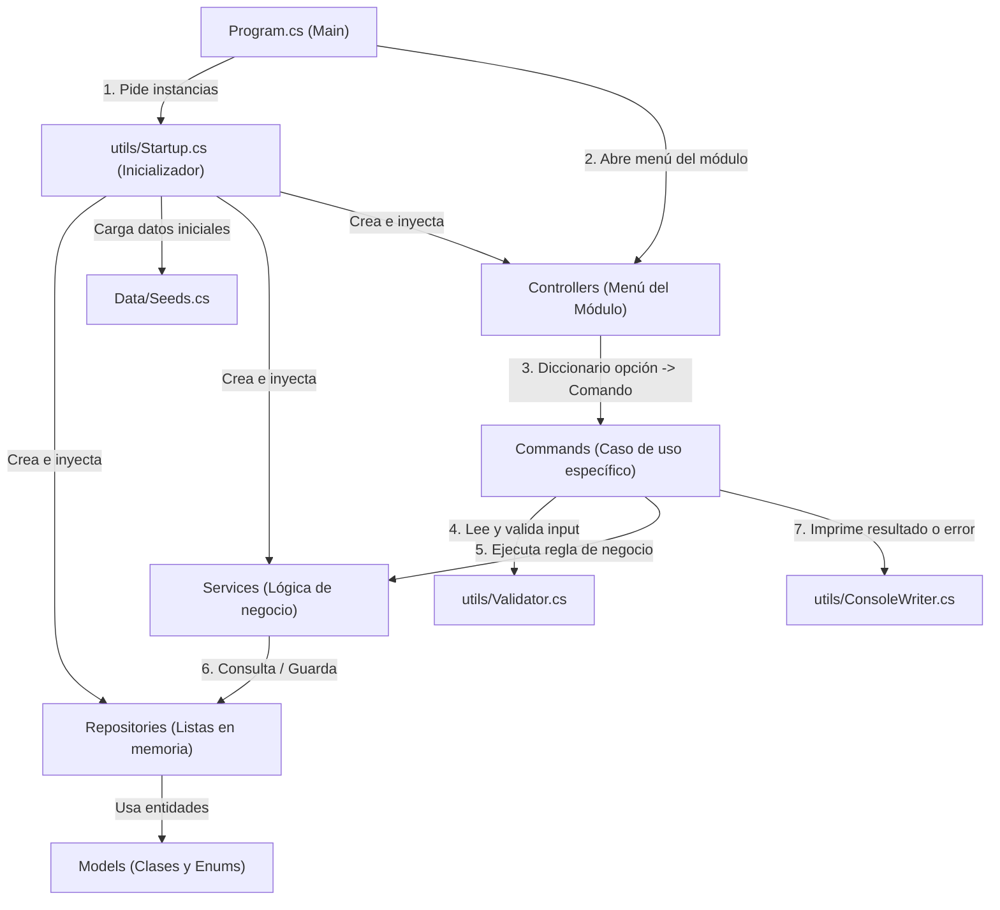

# Guía de Arquitectura y Análisis para el Módulo de Profesores

Este documento explica cómo funcionaba el flujo de trabajo del proyecto anterior (Concesionario de Vehículos / *Car Dealership*) a partir de los archivos restantes en el repositorio, y cómo debes reutilizar exactamente esa misma estructura para construir tu **Módulo de Profesores** en el nuevo **Sistema de Gestión Estudiantil**.

---

## 1. Resumen del Flujo de Trabajo Anterior (Arquitectura por Capas + Patrón Command)

El proyecto anterior sigue una arquitectura limpia dividida por responsabilidades, combinada con tres patrones de diseño muy claros:
1. **Inyección de Dependencias / Singleton manual** en `Startup.cs`.
2. **Patrón Command** (`ICommand`) para cada opción de menú en `Commands/`.
3. **Fluent Builder** en `Validator.cs` para validar entradas del usuario en consola.

### Diagrama del Flujo de Ejecución



---

## 2. ¿Qué hace exactamente cada carpeta y archivo que quedó en el proyecto?

### A. `Models/` (Tus clases de dominio, Enums e Interfaces base)
* **¿Qué había antes?**
  * [`Sale.cs`](Universidad/Models/Sales/Sale.cs): Clase con las propiedades de una venta (`Id`, `VehicleId`, `CustomerName`, `SoldPrice`, `Status`, etc.).
  * [`SaleStatus.cs`](Universidad/Models/Sales/SaleStatus.cs): Un `enum` para los estados de la venta (`Pending`, `Completed`, `Cancelled`).
  * [`Contracts.cs`](Universidad/Models/Contracts.cs): Define la interfaz `ICommand` con los métodos `Execute()` y `Undo()`. **¡Esta interfaz es clave porque todos los comandos de menú la implementan!**
* **¿Por qué estaba casi vacío?**
  * Borraron los modelos viejos (`Vehicle`, `Showroom`, `Stock`, `Workshop`, `WorkOrder`), por eso algunos archivos viejos marcan referencia a ellos aunque ya no estén. Aquí es donde tú y tu equipo crearán las clases de la Universidad (`Profesor`, `Estudiante`, `Curso`, `Grupo`, `Inscripcion`, `Calificacion`, `Asistencia`, `Contrato`, etc.).

### B. `Data/` -> [`Seeds.cs`](Universidad/Data/Seeds.cs) (Datos de prueba pre-cargados)
* **¿Qué hace?**
  * Tiene métodos estáticos (como `Seeds.CreateVehicles()`) que devuelven listas con objetos ya creados (datos "semilla").
* **¿Para qué sirve?**
  * Como no hay base de datos real y todo vive en la memoria RAM mientras la consola está abierta, sería muy tedioso tener que registrar profesores, estudiantes, cursos y grupos manualmente cada vez que presionas *Play* para probar tu código. `Seeds.cs` permite arrancar el programa con profesores, grupos, cursos y alumnos ya creados.

### C. `Repositories/` -> [`SalesRepository.cs`](Universidad/Repositories/Sales/SalesRepository.cs) (Simulación de Base de Datos)
* **¿Qué hace?**
  * Tal como te dijo tu amigo, **simula la base de datos usando colecciones en memoria** (`private readonly List<Sale> _sales = new List<Sale>();`).
  * **Importante:** El repositorio **NO imprime en consola** y **NO tiene reglas de negocio complejas**. Solo tiene métodos tipo CRUD para manipular la lista:
    * `Add(...)`: Agrega un registro a la lista.
    * `GetAll()`: Devuelve todos los elementos (`.ToList()`).
    * `GetById(...)`: Busca con LINQ (`.FirstOrDefault(...)`).
    * Métodos de búsqueda específicos (por ejemplo, buscar grupos por el `Id` o `Cedula` del profesor).

### D. `Services/` -> [`SalesService.cs`](Universidad/Services/Sales/SalesService.cs) (Lógica de Negocio y Excepciones)
* **¿Qué hace?**
  * Es el **cerebro** de cada módulo. Recibe en su constructor el o los `Repositories` que necesita.
  * Aquí van **todas las validaciones de negocio y cálculos** que pide el PDF.
  * **Observa cómo trabaja [`SalesService.cs`](Universidad/Services/Sales/SalesService.cs#L45-L99):**
    * Tampoco usa `Console.WriteLine`.
    * Verifica condiciones (ej. `if (stockItem == null)`, `if (stockItem.Quantity <= 0)`).
    * **Si algo viola las reglas, lanza una excepción (`throw new InvalidOperationException(...)` o tu propia excepción personalizada).** Esto encaja 100% con el PDF, que pide lanzar excepciones cuando vence la fecha tope, cuando una nota está fuera de rango, cuando se intenta marcar asistencia tarde, etc.

### E. `Commands/` -> (`Commands/Sales/*.cs`) (Cada opción del menú es una clase)
* **¿Qué hace?**
  * En lugar de meter 500 líneas de código con `switch-case` dentro del controlador, cada opción del menú es una clase separada que implementa `ICommand` (de `Models/Contracts.cs`).
  * Por ejemplo, en [`SellVehicleCommand.cs`](Universidad/Commands/Sales/SellVehicleCommand.cs):
    1. Limpia pantalla y muestra el título con `_writer.ShowHeader(...)`.
    2. Pide datos al usuario usando `new Validator(...).ReadAndValidate()`.
    3. Llama al servicio (`_salesService.ProcessSaleTransaction(...)`) dentro de un bloque **`try / catch`**.
    4. Si el `Service` lanza una excepción, el `catch (Exception ex)` la atrapa y la muestra bonito en pantalla con `_writer.ShowError(ex.Message)`.
    5. Pausa con `_writer.WaitForKey()`.

### F. `Controllers/` -> [`SalesController.cs`](Universidad/Controllers/SalesController.cs) (El submenú de tu módulo)
* **¿Qué hace?**
  * Representa el menú principal de un módulo (en tu caso, será `ProfesorController` o `TeacherController`).
  * En su constructor recibe el `Service` y el `IConsoleWriter`, e inicializa un diccionario que relaciona cada número del menú con su `ICommand`:
    ```csharp
    _commands = new Dictionary<int, ICommand>
    {
        { 1, new ShowShowroomVehiclesCommand(_salesService, _writer) },
        { 2, new SellVehicleCommand(_salesService, _writer) },
        { 3, new ListSalesCommand(_salesService, _writer) }
    };
    ```
  * Su método `DisplayMenu()` muestra las opciones en un bucle `do-while`, lee la opción con `Validator` y ejecuta `_commands[option].Execute()`.

### G. `utils/` (Herramientas compartidas y `Startup.cs`)
1. **[`Startup.cs`](Universidad/utils/Startup.cs) (¡Tu duda principal!):**
   * **¿Qué hace exactamente?** Es el **Ensamblador / Inicializador central** de toda la aplicación. Cumple dos funciones vitales:
     1. **Mantener una única instancia de los Repositorios (`private static ...Repository?`)**: Fíjate en los métodos `GetShowroomStockRepository()`, `GetSalesRepository()`, etc. Usan variables `static` y un `if (_repo == null)` (Patrón *Singleton*). **¿Por qué?** Porque si el Administrador registra un profesor o le asigna un grupo en el módulo de Administrador, cuando tú inicies sesión como Profesor en el módulo de Profesores, **ambos módulos deben leer la misma lista en memoria**. Si cada quien hiciera `new ProfesorRepository()` por su cuenta, tendrían listas vacías distintas. Además, la primera vez que se crea el repositorio, `Startup` lo llena con los datos de `Seeds.cs`.
     2. **Fábrica de Servicios y Controladores (`Init...Service()`, `Init...Controller()`)**: Crea los servicios pasándoles los repositorios compartidos, y crea los controladores pasándoles los servicios y el `IConsoleWriter`.
2. **[`IConsoleWriter.cs`](Universidad/utils/IConsoleWriter.cs) y [`ConsoleWriter.cs`](Universidad/utils/ConsoleWriter.cs):**
   * Es una clase utilitaria para que nadie escriba `Console.WriteLine` desordenado. Tiene métodos listos para usar:
     * `DisplayInitialMessage("TITULO")`: Título corto con asteriscos `***`.
     * `ShowHeader("TITULO")`: Banner grande con `===` centrado.
     * `DisplayMenu("Encabezado", "Opción 1", "Opción 2")`: Imprime automáticamente la lista numerada `1. Opción 1`, `2. Opción 2`.
     * `ShowMessage(...)` y `ShowError(...)`.
     * `WaitForKey()`: Muestra `"Presione cualquier tecla para continuar..."` y espera un `Console.ReadKey()`.
     * *(Nota: En los comandos viejos de ventas llamaban a métodos como `DisplaySalesTable` que fueron borrados de `ConsoleWriter.cs` para limpiar el proyecto, así que pueden agregar sus propios métodos para imprimir tablas de notas/estudiantes o mostrarlos con `ShowMessage`).*
3. **[`Validator.cs`](Universidad/utils/Validator.cs):**
   * Lee texto desde la consola en un ciclo infinito hasta que cumpla todas las reglas encadenadas:
     ```csharp
     string input = new Validator("Ingrese su opcion: ")
         .NotEmpty()
         .OnlyDigits()
         .InputBetweenXandY(1, 4)
         .ReadAndValidate();
     ```
   * Puedes agregarle más métodos si los necesitas (por ejemplo, validar formato de cédula o contraseña).

### H. [`Program.cs`](Universidad/Program.cs)
* Es el punto de entrada (`Main`). Llama a `Startup` para obtener el `IConsoleWriter` y los `Controllers`, y ejecuta el menú principal del sistema (donde ahora irá el Login por usuario y contraseña y la redirección según el rol: Estudiante, Profesor o Administrador).

---

## 3. Cómo aplicar esta estructura a tu Módulo de Profesores (Según el PDF)

De acuerdo con el documento de requerimientos, al iniciar sesión un usuario con rol **Profesor**, solo tiene permiso para sus funciones (si otro rol intenta entrar, se lanza excepción de acceso denegado).

### Lo que le toca a tu módulo de Profesor:

| # | Función del Profesor (PDF) | Reglas de Negocio y Excepciones Clave |
| :--- | :--- | :--- |
| **1** | **Ver estudiantes de su grupo** | • El profesor solo puede ver los grupos que tiene asignados.<br>• Lista los estudiantes inscritos en el grupo seleccionado. |
| **2** | **Ver notas de su grupo** | • Modo solo lectura para el grupo elegido.<br>• Muestra de cada estudiante: acumulado, examen, nota final y estado (o `"Nota pendiente"`).<br>• Muestra resumen final: cantidad de aprobados, reprobados con derecho a convocatoria y reprobados sin derecho. |
| **3** | **Registrar notas de estudiantes** | • Solo grupos asignados al profesor.<br>• **Excepción** si la fecha tope definida por el Admin ya venció.<br>• Lista solo estudiantes del grupo que **aún no tienen nota** (si intenta registrar a uno que ya tiene, lanza **excepción**).<br>• Pide Acumulado (`0` a `60`) y Examen (`0` a `40`). Si no es numérico o está fuera de rango, lanza **excepción** y vuelve a pedir.<br>• Calcula `NotaFinal = Acumulado + Examen`.<br>• Estados: `>= 60` Aprobado; `40 a 59` Reprobado con derecho a convocatoria; `< 40` Reprobado sin derecho.<br>• Muestra cálculo, advierte que **no se podrán editar** y pide confirmación.<br>• Al confirmar, guarda y muestra de inmediato la lista de notas del grupo. |
| **4** | **Registrar nota extraordinaria (Convocatoria)** | • Esta opción **solo aparece habilitada** si hay estudiantes con derecho a convocatoria (`40` a `59`) que aún no la han realizado.<br>• Aplica validación de **fecha tope** (lanza excepción si venció).<br>• Se ingresa nota de `0` a `100`.<br>• **Tope de 80:** Si saca más de `80`, el sistema registra `80`.<br>• Si la nota resultante es `>= 60` aprueba; si es `< 60` reprueba definitivamente.<br>• No es editable y solo hay 1 convocatoria por clase. |
| **5** | **Marcar asistencia a cada clase** | • Simula la hora de entrada del profesor a su clase.<br>• Tiene **15 minutos hábiles** después de la hora de inicio del grupo (ej. si inicia `7:30`, puede marcar hasta `7:45`).<br>• Si intenta marcar después del límite, lanza **excepción** indicando que ya no puede marcar.<br>• Si no asiste, se registra como ausencia (lo cual descuenta `400` por cada hora de esa clase en su planilla). |
| **6** | **Consultar su contrato y planilla de pago** | • **Contrato:** Muestra grupo, horas (`60h` dominical / `80h` regular), horario y salario base (`400`/hora -> `24,000` dominical / `32,000` regular).<br>• **Planilla de pago:** Muestra salario base, descuentos aplicados por ausencias (`400 * horas de la clase no asistida`) y salario neto. |

---

## 4. Propuesta de Archivos que Deberías Crear para tu Parte

Siguiendo el estándar exacto del proyecto anterior, tu trabajo se dividiría así:

1. **En `Models/`** *(Coordinar nombres con tus 2 compañeros para que todos usen las mismas clases)*:
   * `Profesor.cs` (Nombre, Cédula, Celular, Correo, EstadoCivil, Profesión, Especialidad nullable, Dirección, Género, Usuario, Contraseña).
   * `Grupo.cs` / `Curso.cs` / `Inscripcion.cs` / `Calificacion.cs` (o notas dentro de `Inscripcion`).
   * `AsistenciaProfesor.cs` y `Contrato.cs` / `Planilla.cs`.
   * Enums como `Modalidad` (`Dominical`, `Regular`), `EstadoCalificacion` (`Pendiente`, `Aprobado`, `ReprobadoConConvocatoria`, `ReprobadoSinConvocatoria`).
2. **En `Repositories/`**:
   * `ProfesorRepository.cs` (o repositorios compartidos para Grupos, Inscripciones/Notas y Asistencias).
3. **En `Services/`**:
   * `ProfesorService.cs`: Con los métodos `ObtenerGruposDelProfesor(...)`, `ObtenerEstudiantesPorGrupo(...)`, `RegistrarNotas(...)`, `RegistrarConvocatoria(...)`, `MarcarAsistencia(...)`, `ConsultarContratoYPlanilla(...)`.
4. **En `Commands/Teachers/` (o `Commands/Profesor/`)**:
   * `VerEstudiantesGrupoCommand.cs` (`ICommand`)
   * `ModuloCalificacionesCommand.cs` (o comandos separados para `RegistrarNotasCommand`, `VerNotasGrupoCommand`, `RegistrarConvocatoriaCommand`)
   * `MarcarAsistenciaCommand.cs` (`ICommand`)
   * `ConsultarContratoPlanillaCommand.cs` (`ICommand`)
5. **En `Controllers/`**:
   * `ProfesorController.cs`: Con el menú de opciones del profesor y el `Dictionary<int, ICommand>`.
6. **En `utils/Startup.cs`**:
   * Agregar los métodos `GetProfesorRepository()`, `InitProfesorService()`, `InitProfesorController(IConsoleWriter writer)` para conectar todo al programa principal.

